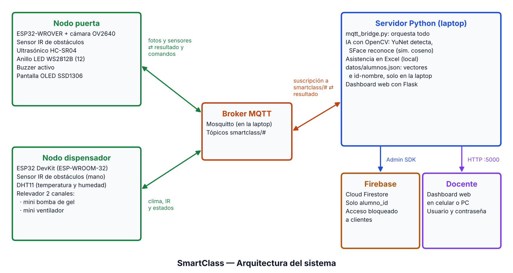
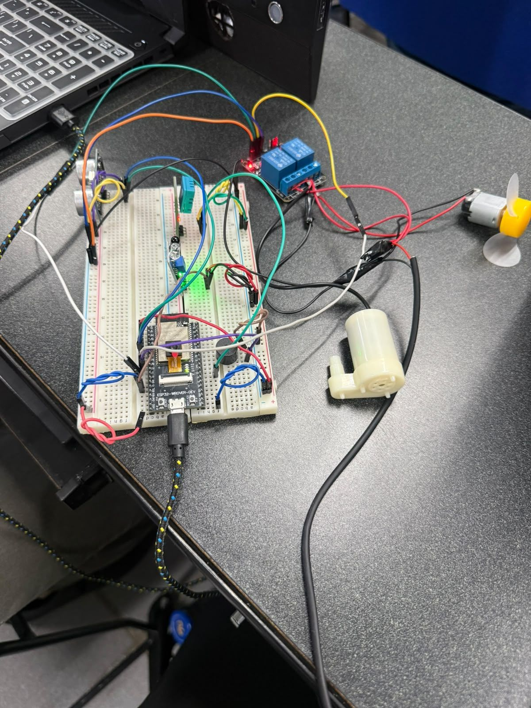
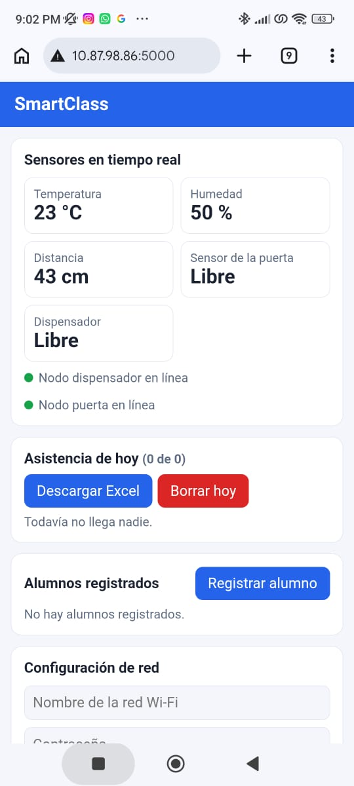
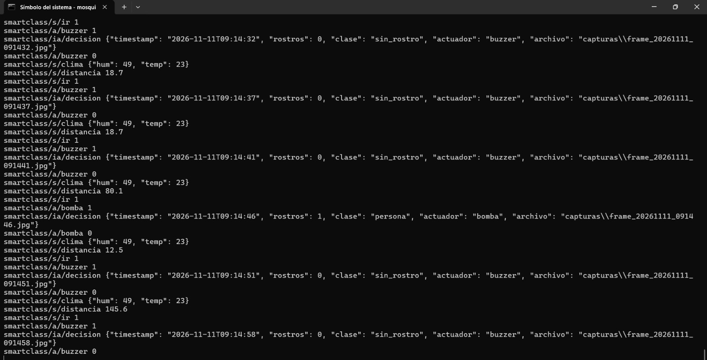
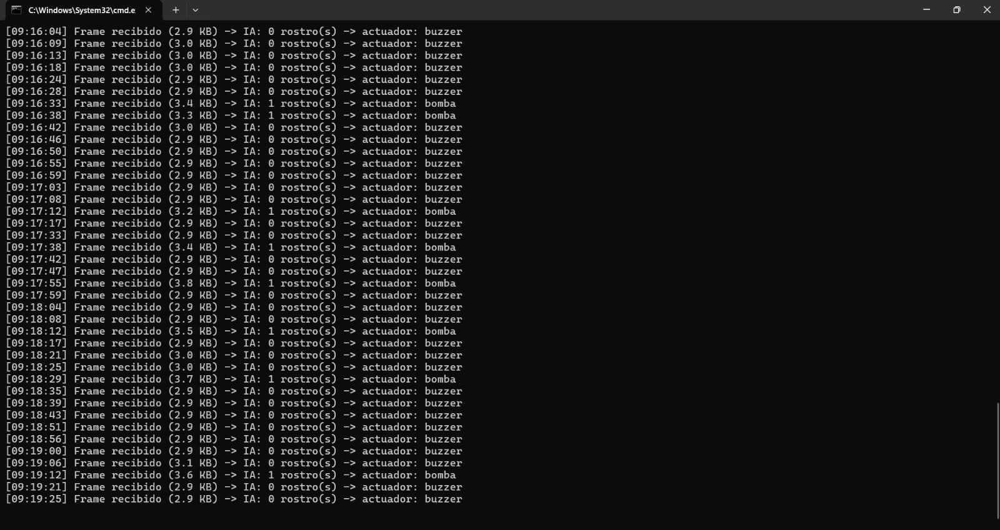
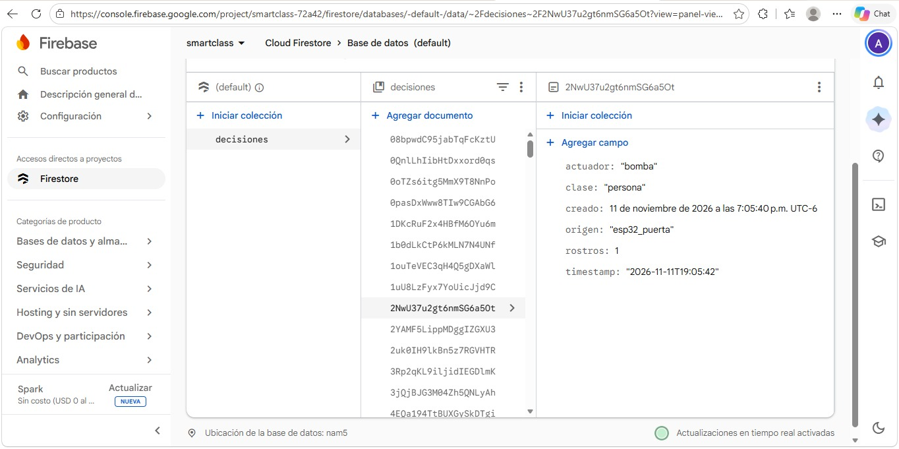

# SmartClass

[](#) [](#) [](#)

> **Semestre:** ago-dic-2026 **Materia:** Sistemas Programables — ISC TecNM León **Integrantes:**

| Nombre                       | Matrícula | Rol                                                      | GitHub      |
|------------------------------|-----------|----------------------------------------------------------|-------------|
| Carrillo Gómez Aldo Emmanuel | 23240343  | 🔧 Código (firmware, servidor, IA, Firebase) · 🔩 Circuito |             |
| Torres Uribe Juan Daniel     | 232402326 | 📝 Documentación                                          | @danielTU03 |

---

## 📌 Descripción General

SmartClass ayuda a profesores, estudiantes y a la institución a ahorrar tiempo de clase, automatizando el pase de lista con reconocimiento facial: una ESP32-CAM envía fotos por MQTT a un servidor Python con IA, que identifica al alumno, registra su asistencia en Firebase y activa los actuadores del salón (buzzer, indicador luminoso, pantalla y dispensador de gel). Resuelve el problema de que pasar lista consume tiempo, de que entran personas no registradas sin que nadie lo note y de que no hay un registro confiable de las condiciones del aula. A diferencia del pase de lista tradicional, también monitorea temperatura, humedad y distancia en tiempo real, guarda un histórico en la nube y muestra todo en un dashboard web que el docente puede abrir desde su celular o computadora.

---

## 🏗️ Arquitectura del Sistema

> 📌 **Inserta aquí tu diagrama de arquitectura como imagen.** No uses texto — coloca una imagen que muestre el flujo completo de tu sistema. Guárdala en `hardware/` y actualiza la ruta abajo.

[](hardware/arquitectura.png)

**Flujo general:** ESP32-CAM → MQTT (`smartclass/cam/frame`) → Servidor Python (OpenCV/IA) → decisión por MQTT → actuadores de la ESP32 → registro en Firebase → dashboard web.

### Tópicos MQTT

| Tópico                      | Dirección          | Descripción                                          |
|-----------------------------|--------------------|------------------------------------------------------|
| `smartclass/s/clima`        | ESP32 → Broker     | Temperatura y humedad (DHT11), en JSON               |
| `smartclass/s/distancia`    | ESP32 → Broker     | Distancia en cm (ultrasónico HC-SR04)                |
| `smartclass/s/ir`           | ESP32 → Broker     | Estado del sensor infrarrojo (0 / 1)                 |
| `smartclass/cam/frame`      | ESP32-CAM → Broker | Frame de cámara (JPEG)                               |
| `smartclass/ia/decision`    | Servidor → Broker  | Decisión de la IA: rostros, clase, actuador y archivo |
| `smartclass/a/bomba`        | Broker → ESP32     | Comando de la bomba de gel (1 = ON)                  |
| `smartclass/a/buzzer`       | Broker → ESP32     | Comando del buzzer (1 = ON)                          |
| `smartclass/a/vent`         | Broker → ESP32     | Comando del ventilador (1 = ON)                      |

---

## 🛠️ Hardware

> Lista según la propuesta inicial del proyecto; se ajusta conforme avanzan los sprints.

| #         | Componente                  | Tipo             | Cantidad | Costo aprox. MXN |
|-----------|-----------------------------|------------------|----------|------------------|
| 1         | ESP32 DevKit                | Microcontrolador | 1        | $120             |
| 2         | ESP32-S2-CAM                | Cámara           | 1        | $180             |
| 3         | Ultrasónico HC-SR04         | Sensor           | 1        | $35              |
| 4         | Fotorresistencia LDR        | Sensor           | 1        | $15              |
| 5         | DHT11                       | Sensor           | 1        | $40              |
| 6         | Buzzer activo               | Actuador         | 1        | $20              |
| 7         | Micro servomotor SG90       | Actuador         | 1        | $60              |
| 8         | Módulo relevador 1 canal    | Actuador         | 1        | $35              |
| 9         | RTC DS3231                  | No convencional  | 1        | $55              |
| 10        | Pantalla OLED 0.96" I2C     | Apoyo visual     | 1        | $75              |
| 11        | Módulo LED flash            | Apoyo visual     | 1        | $25              |
| **Total** |                             |                  |          | **≈ $660 (< $800 MXN)** |

### Diagrama de conexiones

> Inserta aquí una imagen que muestre cómo están conectados los componentes. Puede ser un diagrama hecho en cualquier herramienta (Fritzing, draw.io, Canva, foto del circuito, etc.). Guarda la imagen en `hardware/` y actualiza la ruta abajo.

[](hardware/diagrama.jpg)

---

## 💻 Software y Firmware

### Requisitos del servidor Python

```
pip install -r servidor/requirements.txt
```

### Cómo ejecutar el sistema completo

**1. Levantar el broker MQTT** (en una terminal aparte):

```
mosquitto
```

**2. Cargar firmware en la ESP32:** Abrir Thonny → conectar la ESP32 → cargar los archivos de `firmware/` desde la interfaz gráfica.

**3. Ejecutar el servidor de IA:**

```
cd servidor
python mqtt_bridge.py
```

**4. Abrir el dashboard** desde cualquier dispositivo conectado a la misma red WiFi:

```
http://IP-DE-LA-PC:5000
```

### Librerías ESP32 (MicroPython — corren en la placa)

| Librería               | Uso                                  |
|------------------------|--------------------------------------|
| `umqtt.simple`         | Cliente MQTT en la ESP32             |
| `machine`              | Control de pines GPIO                |
| `network`              | Conexión WiFi                        |
| `dht`                  | Lectura del sensor DHT11             |
| `hcsr04`               | Lectura del sensor ultrasónico       |
| `time`                 | Tiempos y retardos                   |
| *otras según proyecto* |                                      |

### Librerías servidor Python (corren en la PC)

| Librería       | Versión | Uso                         |
|----------------|---------|-----------------------------|
| paho-mqtt      | ≥ 1.6   | Cliente MQTT en el servidor |
| opencv-python  | ≥ 4.8   | Procesamiento de imagen     |
| firebase-admin | ≥ 6.0   | Escritura en Firestore      |
| *librería IA*  | x.x     | *modelo usado*              |

---

## 🧠 Inteligencia Artificial

- **Modelo:** OpenCV para detectar rostros y reconocer alumnos registrados *(confirmar librería y modelo exactos)*
- **Qué detecta:** Si hay un rostro frente a la cámara y si ese rostro pertenece a un alumno registrado.
- **Cómo toma decisiones:**
  - Sin rostro en el frame → activa el buzzer.
  - Rostro detectado → activa la bomba del dispensador de gel.
  - Alumno reconocido → registra la asistencia en Firebase, enciende el indicador verde, suena un buzzer corto y muestra la pantalla de bienvenida.
  - Rostro desconocido → indicador rojo y buzzer largo.
- **Confianza mínima aceptada:** *%* (en las pruebas, un alumno registrado salió con 0.85 y un desconocido con 0.17)

Cada decisión se publica en `smartclass/ia/decision` y se guarda en Firebase.

---

## 📊 Dashboard

Dashboard web accesible desde el celular o la computadora del docente:

- **Sensores en tiempo real:** temperatura, humedad, distancia, sensor de la puerta y del dispensador, y estado en línea de cada nodo.
- **Asistencia de hoy:** lista de alumnos que llegaron, con opción de descargar a Excel.
- **Alumnos registrados:** alta de nuevos alumnos para el reconocimiento facial.
- **Configuración de red:** nombre y contraseña del WiFi.

[](media/dashboard.png)

---

## 🎥 Demostración

**Video demostrativo (YouTube):** [▶️ Ver video](https://youtube.com/watch?v=XXXXXXXX)

### Evidencias del sistema funcionando

| Consola MQTT | Servidor de IA | Firebase |
|--------------|----------------|----------|
| [](media/consola-mqtt.png) | [](media/consola-ia.png) | [](media/firebase-decisiones.png) |

### Fotos del prototipo final

| Vista frontal | Vista interna | Sistema en operación |
|---------------|---------------|----------------------|
| [](media/prototipo-frontal.jpg) | [](media/prototipo-interno.jpg) | [](media/sistema-operacion.jpg) |

---

## 📋 HAL — Hardware Abstraction Layer

| # | Componente                 | Pin ESP32        | Tópico MQTT            | Unidad  | Rango válido |
|---|----------------------------|------------------|------------------------|---------|--------------|
| 1 | Infrarrojo (IR)            | GPIO 13          | smartclass/s/ir        | Digital | 0-1          |
| 2 | Ultrasónico (HC-SR04)      | Trig: 32, Echo: 35 | smartclass/s/distancia | cm      | 2-400        |
| 3 | DHT11 (ambiental)          | GPIO 33          | smartclass/s/clima     | °C / %  | 0-50 °C      |
| 4 | Bomba de gel (Relevador 1) | GPIO 25          | smartclass/a/bomba     | Digital | 0-1          |
| 5 | Buzzer activo              | GPIO 26          | smartclass/a/buzzer    | Digital | 0-1          |
| 6 | Ventilador (Relevador 2)   | GPIO 27          | smartclass/a/vent      | Digital | 0-1          |
| 7 | Cámara ESP32               | FPC interno      | smartclass/cam/frame   | JPEG    | —            |

---

## 🔥 Esquema Firebase

Base de datos Cloud Firestore (proyecto `smartclass`). Detalle de cada campo en [`firebase/esquema.md`](firebase/esquema.md).

```
/lecturas/{timestamp}
    temperatura, humedad, distancia_cm, ir_puerta, ir_dispensador
/decisiones/{id}
    clase: "persona" | "sin_rostro"
    rostros: 1
    actuador: "bomba" | "buzzer"
    origen: "esp32_puerta"
/eventos_ia/{timestamp}
    deteccion: "Aldo Carrillo" | "desconocido"
    confianza: 0.852
    accion: "anillo_verde+buzzer_corto+pantalla_bienvenida"
    alumno_id, asistencia_nueva
/asistencias/{timestamp}
    alumno, fecha, hora
/estado_actual
    último estado de sensores y actuadores
```

---

## ⚠️ Retos técnicos encontrados

*(Llenar al finalizar el proyecto — esta sección alimenta las conclusiones del reporte)*

---

*Sistemas Programables · ISC TecNM León · ago-dic-2026*
