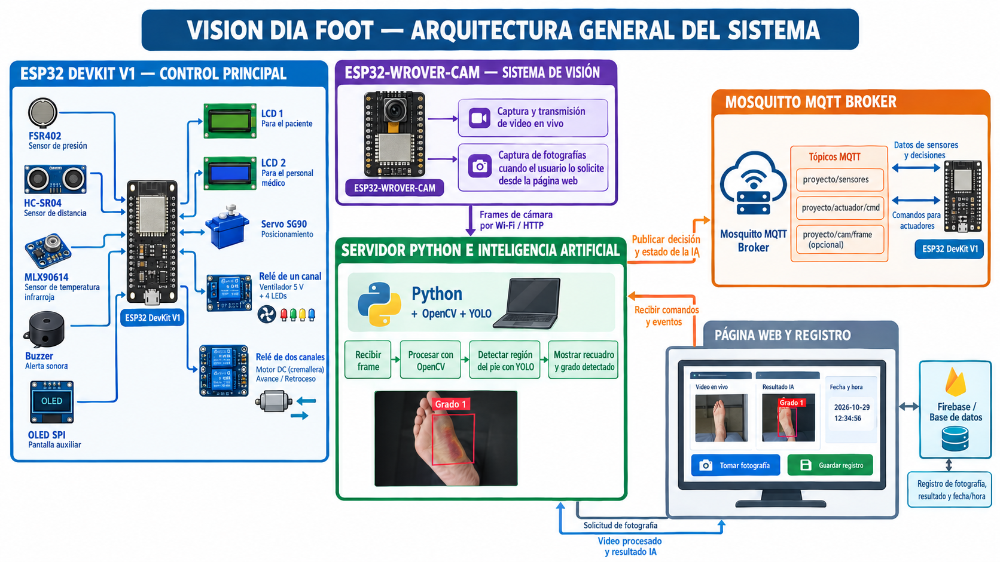
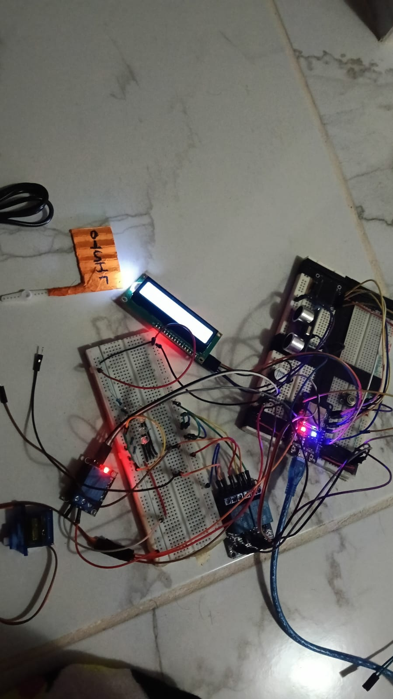

# [PIE DIABETICO - VISION DIA FOOD]


> **Carrera:** Ingeniería en Sistemas Computacionales
> **Semestre:** ago-dic-2026
> **Materia:** Sistemas Programables — ISC TecNM León
> **Equipo:** 17
> **Integrantes:**

| Nombre | Matrícula | Rol | GitHub |
|--------|-----------|-----|--------|
| GEOVANNI MORENO GOMEZ | 23240475 | Firmware ESP32/WROVER, Servidor Python/IA, Firebase/Interfaz | [@GeovanniMoreno](https://github.com/GeovanniMoreno) |
| DANNA VALERIA ANGELES PEREZ | 23240335 | Hardware, Carcasa, Documentación | [@Danna-noob](https://github.com/Danna-noob) |
| ANDREA LOPEZ ESTRADA | 23240168 | Carcasa, Edición video | Usuario no proporcionado |

---


## 📌 Descripción General

Vision Dia Foot es un prototipo de estación automatizada diseñado para apoyar a personal médico y profesionales capacitados en la revisión preventiva del pie diabético. Busca identificar posibles señales de riesgo, como alteraciones de temperatura, presión y lesiones visibles, que pueden pasar desapercibidas en personas con neuropatía periférica.

El sistema integra sensores físicos, una cámara y un modelo de inteligencia artificial para analizar el pie y presentar información al personal médico y al paciente. Su propósito es apoyar la evaluación y facilitar la detección temprana de posibles problemas, sin sustituir un diagnóstico médico ni las pruebas clínicas necesarias para diagnosticar diabetes.

---


## 🏗️ Arquitectura del Sistema




### Descripción del flujo

1. **Adquisición de datos:** la ESP32 DevKit consulta los sensores conectados y administra la secuencia de operación, las pantallas y los actuadores mediante la capa HAL.
2. **Comunicación de control:** la ESP32 DevKit publica las lecturas y el estado de la estación mediante MQTT. También recibe comandos y resultados de IA desde el broker.
3. **Captura de imágenes:** la ESP32-WROVER-CAM funciona como servidor HTTP local. La laptop solicita los fotogramas mediante el endpoint `/frame`; la imagen se transmite en formato RGB565 con resolución QVGA de 320 × 240 píxeles.
4. **Procesamiento visual:** el servidor Python convierte los datos RGB565 a una imagen BGR, procesa los fotogramas con OpenCV y ejecuta la inferencia del modelo YOLO.
5. **Supervisión y almacenamiento:** el servidor publica los resultados de visión por MQTT y expone una API local con FastAPI. El Dashboard desarrollado con Streamlit consulta esa API y los servicios de nube: Cloud Firestore para registros estructurados y Supabase Storage para fotografías.


### Comunicación de la cámara

La transmisión de imágenes entre la ESP32-WROVER-CAM y la laptop utiliza **HTTP**, no MQTT. La dirección del endpoint tiene el siguiente formato:

```text
http://IP_DE_LA_WROVER/frame
```

El endpoint entrega fotogramas RGB565 sin comprimir. El servidor Python comprueba el tamaño esperado de acuerdo con la resolución configurada, convierte los datos y los entrega al modelo YOLO. MQTT se reserva para las lecturas de sensores, estados, comandos y resultados de IA.


### Tópicos MQTT

| Tópico | Dirección | Descripción |
|--------|-----------|-------------|
| `proyecto/sensores/lectura` | ESP32 DevKit → Broker → Laptop | Lecturas de FSR402, distancia, temperatura y otros valores disponibles. |
| `proyecto/actuador/estado` | ESP32 DevKit → Broker → Laptop | Estado de la estación, actuadores y secuencia de revisión. |
| `proyecto/actuador/cmd` | Laptop → Broker → ESP32 DevKit | Comandos de control, confirmaciones y parada de emergencia. |
| `proyecto/ia/decision` | Laptop → Broker → ESP32 DevKit | Resultado de inferencia YOLO, detecciones y nivel de confianza. |
| `proyecto/camara/estado` | Laptop → Broker → ESP32 DevKit | Disponibilidad de cámara y estado del procesamiento YOLO. |
| `proyecto/camara/cmd` | Emisor MQTT autorizado → Broker → Laptop | Suscripción configurada para solicitudes de captura. El emisor debe contar con permiso de escritura en la ACL del broker. |


> **Nota:** el Dashboard selecciona al paciente mediante la API HTTP local (`/patient`) del servidor FastAPI. Esta comunicación es a parte de la transferencia de fotogramas y los tópicos MQTT.

---


## 🛠️ Hardware

> Se agrega únicamente el costo y total de los componentes que tuvieron que adquirise durante este curso, porque ya contabamos con el resto de material 

| # | Componente | Tipo | Cantidad | Costo MXN |
|---|-----------|------|----------|-----------------|
| 1 | Cargador de 5V | NA | 1 | $80 |
| 2 | ESP 32 DevKit | Microcontrolador | 1 | $170 |
| 3 | ESP 32 WROVER CAM | Microcontrolador y cámara | 1 | $286 |
| 4 | Pantalla OLED | Actuador | 1 | $120 |
| 5 | Módulo Relevador de 2 canales | Actuador (control de motor) | 1 | $55 |
| 6 | Sensor de fuerza/presión FSR402 | Sensor | 1 | $225 |
| 7 | Sensor infrarrojo de temperatura MLX90614 | Sensor | 1 | $220 |
| 8 | Sensor ultrasónico HC-SR04 | Sensor de distancia | 1 | Disponible previamente |
| 9 | Pantalla LCD1602 I2C | Interfaz de visualización | 1 | Disponible previamente |
| 10 | Servo SG90 | Actuador | 1 | Disponible previamente |
| 11 | Buzzer | Actuador de alerta | 1 | Disponible previamente |
| 12 | Módulo relevador de 1 canal | Control de ventilación/LED | 1 | Disponible previamente |
| **Subtotal de componentes indicados** | | | | **$1,156 MXN** |


### Diagrama de conexiones



---


## 💻 Software y Firmware

### Estructura principal de archivos

Se presenta la organización del repositorio dentro de la carpeta correspondiente al equipo:

```text
 equipo-17-piediadiafoot/
 ├── docs/
 │   ├── 01_DOCUMENTACION TECNICA.md
 │   ├── 02_MANUAL INSTALACION EJECUCION.md
 │   ├── 03_MANUAL FIREBASE SUPABASE.md
 │   ├── 04_LIMITACIONES Y DECISIONES TECNICAS.md
 │   ├── 05_CONEXIONES Y OPERACION.md
 │   ├── 06_VALIDACION Y PUESTA EN MARCHA.md
 │   ├── 07_DIAGRAMA DE CLASES.mmd
 │   └── 08_REPORTE FINAL.pdf    
 ├── firebase/
 │   ├── esquema.md
 │   ├── estado de seguridad.md
 ├── firmware/
 │   ├── config.json
 │   ├── lcd1602.py
 │   ├── main.py
 │   ├── mqtt_client.py
 │   ├── ssd1306.py
 │   ├── cam/
 │   │   └── main.py
 │   └── hal/
 │       ├── hal.py
 │       └── _init_.py
 ├── hardware/
 │   ├── arquitectura.png
 │   ├── diagrama.jpeg
 │   ├── Medidas Prototipo.pdf
 │   ├── Modelo 3D.pdf
 │   └── tabla_conexiones.pdf
 ├── interfaz/
 │   ├── dashboard.py
 │   └── .env.example
 ├── media/
 │   ├── dashboard/
 │   │   └── [evidencias en formato jpeg o mp4]
 │   ├── hardware/
 │   │   └── [evidencias en formato jpeg o mp4]
 │   ├── mqtt/
 │   │   └── [evidencias en formato jpeg o mp4]
 │   └── prototipo/
 │       └── [imagenes en formato png]
 ├── servidor/
 │   ├── mqtt_bridge.py
 │   ├── config_ia.json
 │   ├── requirements.txt
 │   ├── .env.example
 │   ├── ejemplos/
 │   │   ├── comando_motor_adelante.json
 │   │   ├── comando_motor_atras.json
 │   │   ├── comando_parada.json
 │   │   ├── decision_ia.json
 │   │   └── lectura_sensores.json
 │   ├── ia/
 │   │   ├── best.pt
 │   │   └── MODELO_YOLO.txt
 │   ├── mosquitto/
 │   │   ├── aclfile
 │   │   └── mosquitto.conf.example
 │   └── pruebas/
 │       ├── prueba_firebase.py
 │       ├── prueba_subida.py
 │       └── prueba_supabase.py
 └── README.md
```

Los archivos de configuración con direcciones IP, contraseñas o rutas locales deben adaptarse al equipo donde se ejecute el proyecto.


### Requisitos del servidor Python

Desde la carpeta raíz del repositorio, instalar las dependencias con:

```bash
python -m pip install -r servidor/requirements.txt
```

El archivo de requisitos debe contemplar las bibliotecas utilizadas por el servidor de visión y el Dashboard:

| Librería | Uso |
|---------|-----|
| `numpy` | Conversión y manipulación de datos de imagen. |
| `opencv-python` | Procesamiento y anotación de fotogramas. |
| `ultralytics` | Carga y ejecución del modelo YOLO. |
| `paho-mqtt>=2.0` | Cliente MQTT de la laptop. |
| `fastapi` | API local utilizada por el Dashboard. |
| `uvicorn` | Ejecución de la API FastAPI. |
| `pydantic` | Validación de datos recibidos por la API. |
| `streamlit` | Interfaz gráfica de supervisión. |
| `requests` | Solicitudes HTTP desde el Dashboard. |
| `python-dotenv` | Carga de variables de configuración local. |
| `firebase-admin` | Acceso a Cloud Firestore desde el servidor. |
| `supabase` | Almacenamiento de imágenes en Supabase Storage. |


### Cómo ejecutar el sistema completo

**1. Configurar y levantar el broker MQTT.**

Instalar Mosquitto y adaptar `servidor/mosquitto/mosquitto.conf.example` a las rutas locales de `password_file` y `acl_file`. Crear las credenciales de los usuarios indicados en la ACL y mantener `allow_anonymous false`.

Ejemplo de ejecución, utilizando la ruta de configuración correspondiente a la instalación local:

```bash
mosquitto -c RUTA_LOCAL/mosquitto.conf -v
```

**2. Configurar y cargar la ESP32 DevKit.**

Editar localmente `firmware/ESP32_DevKit/config.json` con el SSID, contraseña Wi-Fi, dirección IP del broker MQTT y credenciales correspondientes al usuario `esp32_user`. Cargar mediante Thonny los archivos de `firmware/ESP32_DevKit/` a la raíz del sistema de archivos MicroPython de la placa.

**3. Iniciar la ESP32-WROVER-CAM.**

Configurar localmente las credenciales Wi-Fi en el firmware de la WROVER y cargar `firmware/ESP32_WROVER/main.py` en la placa como `main.py`. Verificar en la consola la dirección IP obtenida y comprobar que la página de cámara y el endpoint `/frame` respondan desde la misma red local.

**4. Configurar y ejecutar el servidor de visión.**

Editar `servidor/config_ia.json` para establecer:

- `mqtt_host`: dirección IP de la computadora que ejecuta Mosquitto.
- `mqtt_user` y `mqtt_password`: credenciales del usuario `vision_user`.
- `camera_stream_url`: dirección `http://IP_DE_LA_WROVER/frame`.
- `model_path`: ruta local del archivo `best.pt` (por ejemplo, `ia/best.pt` si se ejecuta desde `servidor/`).
- `confidence`: umbral de confianza configurado en `0.35`.

Crear `servidor/.env` a partir de `servidor/.env.example` y completar localmente las variables de Firebase y Supabase. Después ejecutar:

```bash
cd servidor
python vision_mqtt.py
```

El programa inicia el cliente MQTT, obtiene los fotogramas HTTP, ejecuta YOLO y levanta la API FastAPI local en `http://127.0.0.1:8000`.

**5. Configurar e iniciar el Dashboard.**

Crear `interfaz/.env` a partir de `interfaz/.env.example`, utilizando las credenciales locales requeridas para Firebase y Supabase. Con el servidor de visión activo, ejecutar:

```bash
cd interfaz
streamlit run dashboard.py
```

El Dashboard permite consultar sesiones y capturas, administrar los registros de pacientes y revisar el estado de los servicios conectados.


### Librerías ESP32 (MicroPython — corren en la placa)

| Librería o módulo | Uso |
|---------|-----|
| `machine` | GPIO, ADC, PWM, I2C y SPI en la ESP32 DevKit. |
| `network` | Conexión Wi-Fi. |
| `time` | Temporización del firmware. |
| `ujson` | Lectura y generación de mensajes JSON. |
| `umqtt.simple` / cliente local `mqtt_client.py` | Comunicación MQTT de la DevKit. |
| `camera` | Captura de imágenes en el firmware de la ESP32-WROVER-CAM compatible con la API utilizada. |
| `socket` | Servidor HTTP local de la cámara. |

---


## 🧠 Inteligencia Artificial

- **Modelo:** YOLO, ejecutado mediante la biblioteca Ultralytics y los pesos del archivo `best.pt`.
- **Qué detecta:** el modelo identifica y clasifica las categorías de alteraciones o lesiones del pie diabético definidas durante su entrenamiento. Los nombres de las clases se obtienen de los metadatos del propio modelo (`result.names`).
- **Cómo toma decisiones:**
  1. La ESP32-WROVER-CAM captura un fotograma QVGA en formato RGB565.
  2. El servidor Python solicita el fotograma por HTTP mediante `/frame`.
  3. NumPy y OpenCV convierten los datos al formato de imagen utilizado por el procesamiento.
  4. YOLO ejecuta la inferencia con el umbral configurado.
  5. El servidor obtiene la clase detectada, el nivel de confianza y las coordenadas de cada cuadro delimitador.
  6. El resultado se publica como un mensaje JSON en `proyecto/ia/decision`, para que la ESP32 DevKit lo reciba dentro de su secuencia de operación.
- **Confianza mínima aceptada:** _85%_ 

> Debido a que el modelo de IA fue entrenado con ayuda de los diagnósticos de la fundación podemos garantizar y justificar el porcentaje de confianza aceptada en dicho modelo.

---


## 🎥 Demostración
**Video demostrativo (YouTube):** [▶️ Ver video](https://youtu.be/8TXUw_Kkb7M)

---


## 📋 HAL — Hardware Abstraction Layer

La capa HAL concentra el acceso a periféricos de la ESP32 DevKit para que el programa principal gestione el flujo de revisión sin controlar directamente cada pin. Las lecturas de sensores se agrupan en `proyecto/sensores/lectura`; los comandos destinados a actuadores se reciben mediante `proyecto/actuador/cmd`. Las pantallas se actualizan localmente y no requieren un tópico individual.

| # | Componente | Pin ESP32 | Tópico MQTT | Unidad | Rango o condición configurada |
|---|-----------|-----------|-------------|--------|-------------|
| 1 | Sensor FSR402 | GPIO34 (ADC) | `proyecto/sensores/lectura` | Lectura ADC cruda | 0–4095; umbral configurado de 1000 y liberación de 850. Requiere divisor con resistencia de 10 kΩ. |
| 2 | Sensor ultrasónico HC-SR04 | GPIO14 (TRIG), GPIO35 (ECHO) | `proyecto/sensores/lectura` | cm | Ventana de posición configurada de 5–29 cm. ECHO requiere adaptación de nivel de 5 V a un nivel seguro para ESP32. |
| 3 | Sensor infrarrojo MLX90614 | GPIO21 (SDA), GPIO22 (SCL) | `proyecto/sensores/lectura` | °C | Envía temperatura ambiente y de objeto cuando hay lectura. La validación automática por diferencia térmica permanece deshabilitada en la configuración compartida; la confirmación es manual. |
| 4 | Buzzer | GPIO25 | `proyecto/actuador/cmd` | ON/OFF / duración | Activación por comandos de alerta o señal sonora. |
| 5 | Servo SG90 / bandera de estado | GPIO13 (PWM) | Control local de la secuencia | grados | Ángulos configurados entre 20° y 150°; oculto 30° y listo 120°. Utilizar fuente adecuada y GND común para la señal. |
| 6 | Relevador de 2 canales para motor | GPIO32 (IN1), GPIO33 (IN2) | `proyecto/actuador/cmd` | Dirección / pulso | Comandos de avance, retroceso y paro. La configuración compartida conserva `motor_enabled=false` y `physical_stops_confirmed=false` como bloqueo preventivo. |
| 7 | Relevador de 1 canal para ventilación/LED | GPIO26 | Control local de la secuencia / estado MQTT | ON/OFF | Salida activa en LOW según la configuración del módulo. |
| 8 | Pantalla LCD1602 I2C | GPIO21 (SDA), GPIO22 (SCL) | No aplica directamente | Texto | Comparte el bus I2C con el MLX90614. |
| 9 | Pantalla OLED SPI | GPIO18 (SCK), GPIO23 (MOSI), GPIO4 (DC), GPIO2 (RES) | No aplica directamente | Texto | CS físico a GND, verificar que el montaje final corresponda con esa conexión. |

> **Seguridad:** la configuración mantiene deshabilitado el accionamiento del motor hasta confirmar los parámetros de seguridad mecánica y eléctrica (en caso de modificar el prototipo físico). No habilitarlo únicamente por cambiar un valor en `config.json`; deben verificarse corriente, relevadores, topes físicos, alimentación y paro de emergencia en el montaje correspondiente.
---


## 🔥 Esquema Firebase

El proyecto utiliza **Cloud Firestore** para almacenar registros estructurados. Las fotografías originales y anotadas se almacenan en **Supabase Storage**; Firestore guarda los metadatos y las rutas correspondientes.

```text
Cloud Firestore
│
├── pacientes/{patient_id}
│   ├── nombre: string
│   ├── apellido: string
│   ├── nombre_completo: string
│   ├── created_at: timestamp
│   └── activo: boolean
│
└── sesiones/{session_id}
    ├── project: string
    ├── session_id: string
    ├── foot_side: string
    ├── patient_id: string | null
    ├── patient_name: string | null
    ├── started_at: timestamp
    ├── estado: string
    ├── medical_note: string
    ├── finished_at: timestamp (al finalizar)
    │
    └── capturas/{capture_id}
        ├── project: string
        ├── session_id: string
        ├── patient_id: string | null
        ├── patient_name: string | null
        ├── capture_index: number
        ├── timestamp_local: string
        ├── capture_source: string
        ├── foot_side: string
        ├── detections: array
        ├── sensor_readings: map
        ├── station_state: map
        ├── local_files: map
        ├── supabase_bucket: string
        ├── supabase_original_path: string | null
        ├── supabase_annotated_path: string | null
        ├── cloud_status: string
        ├── cloud_errors: array
        └── medical_note: string
```


### Almacenamiento de imágenes

- **Servicio:** Supabase Storage.
- **Bucket predeterminado en el código:** `capturas-dia-foot`.
- **Organización de objetos:** `sesiones/{session_id}/`.
- **Archivos:** imagen original y versión anotada por YOLO.
- **Firestore:** almacena los metadatos de cada captura y las rutas de los objetos guardados en Supabase.

La estructura se describe a partir de las operaciones realizadas por `vision_mqtt.py` y `dashboard.py`. Las credenciales de Firebase Admin SDK y Supabase se configuran localmente y no forman parte del repositorio público.

---


## ⚠️ Retos técnicos encontrados

1.Transmisión de video: fue necesario separar la transmisión de fotogramas del intercambio de mensajes de control, dedido a que se presentaron problemas de fluidez y pixelación durante la recepción de imágenes de la ESP32-WROVER-CAM en el servidor Python.

2.Validación del modelo de IA: las métricas de validación de YOLO fueron bajas, por lo que sus resultados deben interpretarse con precaución.

3.Pruebas del prototipo: hubo varios falsos al conectar los componentes con jumpers, además de que se dificulto el acodomodo físico en el prototipo.

4.Calibración de sensores: la lectura del FSR requiere establecer umbrales con muestras de referencia y el criterio térmico necesita calibración antes de habilitar una validación automática. También fue necesario revisar conexiones, alimentación y disposición de componentes. La configuración compartida conserva deshabilitados el accionamiento del motor y la confirmación de topes físicos como medidas preventivas en caso de modificaciones físicas.

> En resumen estos 4 problemas son los más significativos, dentro de los reportes en PDF se encuentran de manera más específica y detallada todos los problemas que tuvimos y el cómo los solucionamos

---

*PIE DIABÉTICO - DIA FOOD · Sistemas Programables · ISC TecNM León · ago-dic-2026*
